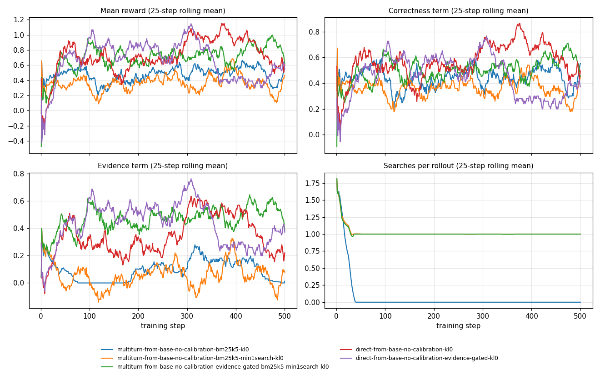

# Multi-turn GRPO: first matched runs (2026-11-01)

RL-2 (Michel), on the RL / agent boundary. Branch `mt-grpo-on-handover` (PR #3, on `controller/grpo-handover` at `9c550c6`). The runs were made on `mt-grpo` (from `agent` at `8fd8da7`, PR #2); commit hashes below are from that branch.
This page records why each run exists, what it changed, and what it showed, so the
numbers can be read without the session that produced them.

## Question

Can GRPO teach the 2B verifier to **search for its own evidence** (call `search`, read the
results, answer with the verifier JSON), and how does that compare with single-turn GRPO
that is handed the evidence? This is the AG-2 deliverable "multi-turn vs single-turn GRPO
on the 900 claims" ([live-backend.md](live-backend.md)).

## Setup shared by every run

- **Claims:** the fixed 1,000-claim GRPO set `verifier/data/train/sft/fever-oracle-matched-grpo-1000`
  (copied from `feat/controller`; disjoint from SFT4500 and from the frozen dev IDs).
- **GRPO:** 8 samples per claim, 2 claims per step, 500 steps (one epoch), learning rate 2e-5,
  beta 0, LoRA of the SFT4500 shape, thinking off.
- **Reward:** `core.reward` with calibration off (`--reward no_calibration`): verdict
  correctness with the harm matrix + 0.5 × evidence score; format failure −2.
  The multi-turn reward also charges 0.02 per search (`L3_COST`).
- **Search tool (multi-turn):** ranked BM25, 3 candidate pages, 5 sentences per search,
  at most 2 searches, 2 extra turns that answer "No searches left" to further calls.
- **Evaluation:** the 900 frozen dev IDs. Multi-turn models use `verifier/evaluation/eval_multiturn.py`
  (same tool, prompt and TRL tool-call parser as training, greedy decoding, scored by the
  shared `score()` / `summarize()`). Single-turn models use the shared evaluator with title
  retrieval and the direct prompt, 1,024-token cap.

## Step 1: does the starting model call the tool? (no training, lr 0)

| Start | Rollouts that searched | Valid final JSON | Ended on an unanswered call |
|---|---:|---:|---:|
| SFT4500 (JSON SFT) | 1 / 120 | 116 / 120 | 0 / 120 |
| Base Qwen3.5-2B | 120 / 120 | 90 / 120 | 24 / 120 |

30 train claims × 4 samples each (job 1055567, A100). Rollouts, logs and metadata
(adapter weights omitted) are under
`verifier/experiments/grpo-multiturn-from-{sft4500,base}-qwen3p5-2b-no-calibration-bm25k5-lr0-probe-30-samples/runs/check2-{sft,base}-a100/`;
they ran from `~/mt-toolcheck` on SoC with `--lr 0 --max-steps 15 --n-train 30 --num-generations 4`,
and their `meta.json` keeps the original config name `mt-toolcheck-bm25-k5`. Greedy evaluation of SFT4500 on 32 dev
claims also made no searches. **Single-turn JSON SFT removed tool use**, so a GRPO run from
SFT4500 would have nothing to reinforce. Both GRPO arms below start from base.
(H100 runs fail in `fla`'s gated-delta backward with this Triton; use A100.)

## Step 2: matched runs from base (900 dev claims)

| Model | Accuracy | FEVER | Evidence F1 (non-NEI) | Recall S / R / NEI | Format | Searches per claim |
|---|---:|---:|---:|---|---:|---:|
| Base, untrained, searching itself | 0.448 | **0.382** | 0.385 | 0.71 / 0.35 / 0.29 | 0.73 | 1.68 |
| Multi-turn GRPO from base (`run1`) | 0.438 | **0.034** | 0.000 | 0.22 / 0.99 / 0.10 | 1.00 | **0.00** |
| Single-turn GRPO from base, oracle context (`run1`) | **0.594** | 0.251 | 0.369 | 0.83 / 0.95 / **0.00** | 1.00 | — |

Configs: `grpo-multiturn-from-base-qwen3p5-2b-no-calibration-bm25k5-kl0-1000-samples` (job
1055678, 33 min, 10.5 GB) and `grpo-direct-from-base-qwen3p5-2b-no-calibration-kl0-1000-samples`
(job 1055679, 99 min, 16.3 GB). Results under `verifier/evaluation/results/<config>/`.
The untrained base row is `base-qwen3p5-2b/multiturn-bm25-k5-calls2/run1`.

**Both arms learned a shortcut the reward allows.**

- **Multi-turn stopped searching.** Searches per rollout fell from 1.8 at step 1 to 0 by step 17
  and stayed there (`logs/train_log.json`, `rewards/searches/mean`). The model answers from the
  claim alone, nearly always REFUTED. Under the harm matrix a wrong REFUTED scores 0, a wrong
  SUPPORTED on a gold-NEI claim scores −0.75, and a search that runs over budget risks −2, so
  "no search, say REFUTED" is a safe policy with a positive average reward.
- **Single-turn never abstains.** Accuracy rose to 59.4%, but NEI recall is 0.3%. Its training
  prompts always contain the gold pages (oracle context), and a wrong REFUTED/SUPPORTED on an
  NEI claim is cheaper than missing a supported verdict.

## Step 3: multi-turn rerun requiring one search

Config `grpo-multiturn-from-base-qwen3p5-2b-no-calibration-bm25k5-min1search-kl0-1000-samples`
adds `--min-searches 1`: an answer given before any real search scores as a format failure.
This is the tool prompt's own instruction ("Use the search tool…") and base already searches
in every rollout, so training starts inside the allowed region. The reward is otherwise
unchanged. Job 1056636; evaluation 1056637 runs after it.

Result: searching is enforced, but the verdict shortcut from step 2 remains. From step 23
onward every training rollout predicts REFUTED, and the mean reward stays between 0.30 and
0.52 per 50-step window (see [Training curves](#training-curves)). On the 900 dev claims (job 1056637): accuracy 0.333, FEVER 0.204, recall
S / R / NEI 0.00 / 1.00 / 0.00, one search per claim. It still cites well when it is right
(evidence F1 0.640), which is why FEVER exceeds step 2's 0.034.

## Open decision: a reward change for GRPO only

Both shortcuts come from the same place: a correct SUPPORTED/REFUTED verdict earns full
credit without the evidence that justifies it, and REFUTED is the cheapest wrong answer.
Candidate changes, each added as a new opt-in `RewardConfig` ablation so `FULL`, the existing
ablations, the evaluator and the agent loop are untouched:

1. **Evidence-gated correctness:** a correct SUPPORTED/REFUTED earns correctness credit only
   when it cites at least one gold sentence (the FEVER score's requirement). Gold-NEI claims
   are scored as now.
2. **Symmetric REFUTED harm:** raise the cost of a wrong REFUTED to match a wrong SUPPORTED,
   so REFUTED stops being the safe default. Changes the project's harm asymmetry.
3. Both.

**Decision (2026-11-02, Michel): option 1.** Implemented as `RewardConfig.evidence_gate`
(default off) and the ablation `no_calibration_evidence_gated`; `verifier/tests/test_reward.py`
checks that `FULL` and the older ablations are unchanged, that only this ablation gates, and
that gold-NEI claims and wrong verdicts score as before.

## Step 4: both arms with the evidence-gated reward

| Arm | Config |
|---|---|
| Multi-turn, one search required | `grpo-multiturn-from-base-qwen3p5-2b-no-calibration-evidence-gated-bm25k5-min1search-kl0-1000-samples` |
| Single-turn, oracle context | `grpo-direct-from-base-qwen3p5-2b-no-calibration-evidence-gated-kl0-1000-samples` |

Everything else matches steps 2–3. Expected if the gate works: NEI recall rises above the
step-2 values (0.10 and 0.00), the REFUTED share falls toward the gold share, and FEVER moves
closer to accuracy, because unsupported right verdicts no longer pay.

Jobs 1056946 / 1056947 (training, about 1.5 h each on A100-40), evaluations 1056948 / 1056949.

### All runs on the 900 dev claims

| Model | Reward | Accuracy | FEVER | Evidence F1 | Recall S / R / NEI | Harm-weighted error | Searches |
|---|---|---:|---:|---:|---|---:|---:|
| Base, untrained, searching itself | — | 0.448 | 0.382 | 0.385 | 0.71 / 0.35 / 0.29 | 0.659 | 1.68 |
| Multi-turn GRPO (step 2) | no calibration | 0.438 | 0.034 | 0.000 | 0.22 / 0.99 / 0.10 | 0.578 | 0.00 |
| Multi-turn GRPO, one search (step 3) | no calibration | 0.333 | 0.204 | 0.640 | 0.00 / 1.00 / 0.00 | 0.667 | 1.00 |
| **Multi-turn GRPO, one search (step 4)** | **evidence-gated** | **0.676** | **0.540** | 0.623 | **0.78 / 0.84 / 0.41** | **0.382** | 1.00 |
| Single-turn GRPO, oracle context (step 2) | no calibration | 0.594 | 0.251 | 0.369 | 0.83 / 0.95 / 0.00 | 0.480 | — |
| Single-turn GRPO, oracle context (step 4) | evidence-gated | 0.443 | 0.419 | 0.131 | 0.34 / 0.02 / 0.96 | 0.569 | — |

### What the gate did

- **Multi-turn: GRPO now learns the task.** Training reward rose steadily (0.51 → 0.81 per
  50-step window), every rollout stayed valid, and predicted verdicts stayed mixed (about
  40% NEI, 35% SUPPORTED, 20–25% REFUTED to the end). On dev it improves on the untrained
  base by +22.8 points accuracy and +15.8 FEVER, with one search of 5 sentences per claim
  and no SFT. It is the only run in this study that keeps all three labels.
- **Single-turn: the gate traded one collapse for another.** Training reward peaked near
  step 250 (0.89 per 25 steps) and fell to 0.55 by the end; on dev the model now answers
  NEI for 96% of NEI claims but also for most supported and refuted ones (recall 0.34 / 0.02).
  FEVER rose (0.251 → 0.419) because unsupported right answers were already scored as FEVER
  errors, but accuracy fell. Trained on oracle context, it learned that citing the wrong
  sentence costs the whole verdict, and abstains whenever the shown context is unfamiliar
  (titles retrieval at evaluation).

### Caveats before comparing arms

- **The arms see different evidence at evaluation.** Multi-turn reads only what its own search
  returns (5 sentences); single-turn reads the title-retrieval context (up to 100 sentences).
  This is the matched-training comparison, not a matched-context one.
- **One seed each,** and all numbers are on the 900 dev claims, which earlier prompt work also
  used. Confirm the multi-turn result on the frozen holdout (`fever-evaluation-v1/holdout-3000-ids.json`)
  and with a second seed before reporting it as a finding.
- **Reference points, not matched:** Chien Hung's SFT4500 → CoT GRPO reaches 0.747 accuracy and
  0.673 FEVER with oracle-trained thinking and title retrieval at evaluation.

### Training curves



Per 50-step window, from each run's committed `artifacts/logs/train_log.json`; the predicted-label
shares come from `artifacts/rollouts.jsonl` (multi-turn runs only; single-turn runs did not save
rollouts). Regenerate the figure and tables with

```
python -m verifier.evaluation.grpo_training_curves --window 50 \
  --figure verifier/docs/figures/multiturn-grpo-training.png \
  --runs verifier/experiments/<config>/runs/run1 [...]
```

Rewards are not comparable across reward configurations: under the evidence gate the
correctness term is zero for an uncited right verdict, so the gated runs' reward is on a
different scale from the ungated ones. Compare runs on the dev metrics above.

**Multi-turn, step 2**: `grpo-multiturn-from-base-qwen3p5-2b-no-calibration-bm25k5-kl0-1000-samples` / `run1` (reward `no_calibration`, 50-step windows)

| steps | reward | correctness | evidence | valid format | searches | pred S | pred R | pred NEI |
|---|---:|---:|---:|---:|---:|---:|---:|---:|
| 1-50 | 0.48 | 0.46 | 0.12 | 0.98 | 0.34 | 0.37 | 0.41 | 0.21 |
| 51-100 | 0.49 | 0.49 | 0.01 | 1.00 | 0.00 | 0.26 | 0.72 | 0.02 |
| 101-150 | 0.36 | 0.36 | 0.00 | 1.00 | 0.00 | 0.40 | 0.60 | 0.00 |
| 151-200 | 0.40 | 0.38 | 0.05 | 1.00 | 0.00 | 0.41 | 0.42 | 0.17 |
| 201-250 | 0.50 | 0.45 | 0.13 | 0.99 | 0.00 | 0.13 | 0.51 | 0.36 |
| 251-300 | 0.49 | 0.45 | 0.09 | 1.00 | 0.00 | 0.24 | 0.47 | 0.29 |
| 301-350 | 0.56 | 0.47 | 0.21 | 0.99 | 0.00 | 0.06 | 0.38 | 0.57 |
| 351-400 | 0.53 | 0.46 | 0.16 | 1.00 | 0.00 | 0.00 | 0.41 | 0.58 |
| 401-450 | 0.59 | 0.53 | 0.12 | 1.00 | 0.00 | 0.11 | 0.62 | 0.27 |
| 451-500 | 0.43 | 0.42 | 0.01 | 1.00 | 0.00 | 0.14 | 0.82 | 0.04 |

**Multi-turn, one search, step 3**: `grpo-multiturn-from-base-qwen3p5-2b-no-calibration-bm25k5-min1search-kl0-1000-samples` / `run1` (reward `no_calibration`, 50-step windows)

| steps | reward | correctness | evidence | valid format | searches | pred S | pred R | pred NEI |
|---|---:|---:|---:|---:|---:|---:|---:|---:|
| 1-50 | 0.34 | 0.37 | 0.07 | 0.98 | 1.06 | 0.21 | 0.72 | 0.05 |
| 51-100 | 0.35 | 0.35 | 0.04 | 1.00 | 1.00 | 0.00 | 1.00 | 0.00 |
| 101-150 | 0.30 | 0.34 | -0.04 | 1.00 | 1.00 | 0.00 | 1.00 | 0.00 |
| 151-200 | 0.34 | 0.34 | 0.04 | 1.00 | 1.00 | 0.00 | 1.00 | 0.00 |
| 201-250 | 0.35 | 0.35 | 0.05 | 1.00 | 1.00 | 0.00 | 1.00 | 0.00 |
| 251-300 | 0.44 | 0.40 | 0.12 | 1.00 | 1.00 | 0.00 | 1.00 | 0.00 |
| 301-350 | 0.35 | 0.36 | 0.02 | 1.00 | 1.00 | 0.00 | 1.00 | 0.00 |
| 351-400 | 0.52 | 0.45 | 0.17 | 1.00 | 1.00 | 0.00 | 1.00 | 0.00 |
| 401-450 | 0.36 | 0.35 | 0.07 | 1.00 | 1.00 | 0.00 | 1.00 | 0.00 |
| 451-500 | 0.32 | 0.33 | 0.02 | 1.00 | 1.00 | 0.00 | 1.00 | 0.00 |

**Multi-turn, one search, evidence-gated, step 4**: `grpo-multiturn-from-base-qwen3p5-2b-no-calibration-evidence-gated-bm25k5-min1search-kl0-1000-samples` / `run1` (reward `no_calibration_evidence_gated`, 50-step windows)

| steps | reward | correctness | evidence | valid format | searches | pred S | pred R | pred NEI |
|---|---:|---:|---:|---:|---:|---:|---:|---:|
| 1-50 | 0.51 | 0.42 | 0.37 | 0.96 | 1.05 | 0.35 | 0.19 | 0.45 |
| 51-100 | 0.70 | 0.49 | 0.45 | 1.00 | 1.00 | 0.35 | 0.24 | 0.41 |
| 101-150 | 0.70 | 0.50 | 0.45 | 1.00 | 1.00 | 0.33 | 0.19 | 0.49 |
| 151-200 | 0.66 | 0.46 | 0.43 | 1.00 | 1.00 | 0.24 | 0.16 | 0.60 |
| 201-250 | 0.72 | 0.50 | 0.48 | 1.00 | 1.00 | 0.24 | 0.11 | 0.65 |
| 251-300 | 0.72 | 0.50 | 0.48 | 1.00 | 1.00 | 0.31 | 0.19 | 0.50 |
| 301-350 | 0.75 | 0.52 | 0.51 | 1.00 | 1.00 | 0.19 | 0.09 | 0.72 |
| 351-400 | 0.68 | 0.48 | 0.46 | 1.00 | 1.00 | 0.34 | 0.15 | 0.50 |
| 401-450 | 0.84 | 0.59 | 0.55 | 1.00 | 1.00 | 0.38 | 0.18 | 0.44 |
| 451-500 | 0.81 | 0.58 | 0.51 | 1.00 | 1.00 | 0.35 | 0.23 | 0.41 |

**Single-turn, oracle context, step 2**: `grpo-direct-from-base-qwen3p5-2b-no-calibration-kl0-1000-samples` / `run1` (reward `no_calibration`, 50-step windows)

| steps | reward | correctness | evidence | valid format |
|---|---:|---:|---:|---:|
| 1-50 | 0.55 | 0.48 | 0.27 | 0.97 |
| 51-100 | 0.71 | 0.55 | 0.33 | 1.00 |
| 101-150 | 0.60 | 0.48 | 0.25 | 1.00 |
| 151-200 | 0.64 | 0.51 | 0.27 | 1.00 |
| 201-250 | 0.61 | 0.51 | 0.21 | 1.00 |
| 251-300 | 0.82 | 0.61 | 0.44 | 1.00 |
| 301-350 | 0.95 | 0.67 | 0.56 | 0.99 |
| 351-400 | 1.03 | 0.76 | 0.55 | 1.00 |
| 401-450 | 0.87 | 0.68 | 0.39 | 1.00 |
| 451-500 | 0.58 | 0.48 | 0.21 | 1.00 |

**Single-turn, oracle context, evidence-gated, step 4**: `grpo-direct-from-base-qwen3p5-2b-no-calibration-evidence-gated-kl0-1000-samples` / `run1` (reward `no_calibration_evidence_gated`, 50-step windows)

| steps | reward | correctness | evidence | valid format |
|---|---:|---:|---:|---:|
| 1-50 | 0.44 | 0.35 | 0.29 | 0.97 |
| 51-100 | 0.81 | 0.56 | 0.49 | 1.00 |
| 101-150 | 0.81 | 0.55 | 0.52 | 1.00 |
| 151-200 | 0.82 | 0.56 | 0.51 | 1.00 |
| 201-250 | 0.73 | 0.49 | 0.48 | 1.00 |
| 251-300 | 0.96 | 0.64 | 0.65 | 1.00 |
| 301-350 | 0.81 | 0.54 | 0.54 | 1.00 |
| 351-400 | 0.40 | 0.27 | 0.27 | 1.00 |
| 401-450 | 0.36 | 0.24 | 0.24 | 1.00 |
| 451-500 | 0.58 | 0.39 | 0.39 | 1.00 |

### Next

1. Holdout evaluation of the step-4 multi-turn model (no training needed): running on SoC as of
   2026-11-02, job 1058798 (step-4 model, `run1-holdout3000`) and job 1058799 (untrained base,
   `holdout3000`) on the 3,000 holdout IDs. Results are not in this PR yet.
2. Second seed of the step-4 multi-turn run: job 1058800 (`mt-gated-s1`) is queued, with its
   evaluation 1058801 dependent on it.
3. Single-turn arm: the gate needs either a softer form (partial credit instead of zero) or
   training on retrieval context instead of oracle context; decide with the group.

## Reproduce

```
# on SoC, repo root on branch mt-grpo-on-handover; A100 only
SFT=<SFT4500 run1-json-sft checkpoints>   # LoRA shape only for base-start runs
sbatch --time=36:00:00 --export=ALL,TRAIN_SCRIPT=verifier/experiments/<config>/train.py,SFT_CHECKPOINTS=$SFT,RUN_NAME=<new run> \
  verifier/experiments/run_train.sbatch
sbatch --export=ALL,ADAPTER=<run checkpoints>,EVAL_CONDITION=<config>,RUN_NAME=<new run> \
  verifier/evaluation/eval_multiturn.sbatch
```

Commits: `69bfdbc` (`--train-data`, evaluator), `84cc17d` (evaluator sbatch), `a5272ae` (base
configs), `b60714a` (`--min-searches`). The SoC checkout is `~/rl-test-agent`; the FEVER index
there was built by job 1055351.
